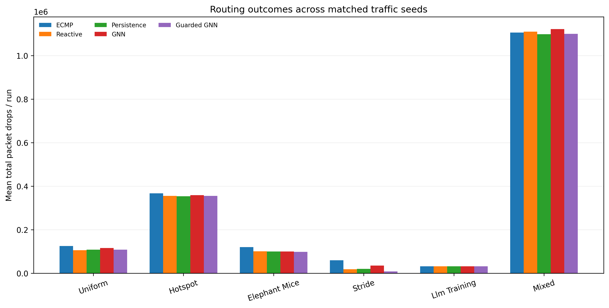

# NeuralFabric - Recorded Pilot Experiment Results

Generated from `benchmark_results.json`. This is the recorded pilot benchmark, not a claim of publication-level statistical significance.

Configuration: 20 training epochs; 150 ticks/run; 3 routing seeds/family; k=4; 1 ms tick.

## Benchmark configuration

| Setting | Value |
|---|---:|
| Data scenarios | 30 |
| Train / val / test scenarios | 21 / 4 / 5 |
| Workload families | 6 |
| Routing strategies | 5 |
| Routing runs | 90 |
| Topology | k=4 Fat-Tree |
| Simulation tick | 1 ms |
| Link capacity | 500 packets/tick |
| Buffer | 2000 packets |

## Forecast quality on held-out scenario windows

| Predictor | F1 @ 0.5 | Average precision | ROC AUC | Brier score |
|---|---:|---:|---:|---:|
| gnn | 0.7940 | 0.8692 | 0.9580 | 0.0676 |
| persistence | 0.8118 | 0.6991 | 0.8799 | 0.0777 |

Positive-label prevalence: 0.2075. Windows within a held-out scenario overlap and are not independent statistical trials.
Persistence holds the last observed congestion label constant. The GNN has stronger AP, ROC AUC, and Brier score but lower F1 at the fixed 0.5 cutoff.

## Mean packet drops per run

Lower is better; each family mean is over matched routing seeds.

| Traffic family | ECMP | Reactive | Persistence | GNN | Guarded GNN |
|---|---:|---:|---:|---:|---:|
| uniform | 125,414 | 105,800 | 108,179 | 115,685 | 108,553 |
| hotspot | 367,280 | 355,871 | 353,731 | 358,582 | 355,600 |
| elephant_mice | 120,190 | 100,818 | 99,822 | 100,162 | 98,349 |
| stride | 59,840 | 18,250 | 20,099 | 35,397 | 8,113 |
| llm_training | 32,291 | 32,239 | 32,228 | 32,214 | 32,291 |
| mixed | 1,105,914 | 1,109,953 | 1,098,154 | 1,122,231 | 1,100,487 |

## Guarded GNN vs ECMP by family

| Family | Mean drop reduction |
|---|---:|
| uniform | 13.44% |
| hotspot | 3.18% |
| elephant_mice | 18.17% |
| stride | 86.44% |
| llm_training | 0.00% |
| mixed | 0.49% |

## Overall routing outcomes

| Strategy | Drops/run | Delivered pkt/tick | Mean delivered delay (ms) | Mean run p99 delay (ms) | Reroutes/run |
|---|---:|---:|---:|---:|---:|
| ecmp | 301,821.5 | 1,852.28 | 9.664 | 17.389 | 0.00 |
| reactive | 287,155.1 | 1,944.11 | 10.606 | 22.944 | 622.83 |
| persistence | 285,368.7 | 1,958.91 | 10.497 | 22.000 | 613.94 |
| gnn | 294,045.2 | 1,899.98 | 10.606 | 22.222 | 588.89 |
| guarded_gnn | 283,899.0 | 1,979.47 | 9.008 | 15.889 | 14.72 |

### Guarded GNN vs ECMP matched-trial summary

15 wins, 3 ties, 0 losses across 18 matched trials.
Mean packet-drop reduction: 5.94%. Mean difference: -17,922.5 packets/run.
Reroute mutation reduction vs reactive: 97.64%.

## Paired descriptive intervals

Bootstrap resampling uses only three paired seeds per family; intervals are descriptive rather than definitive significance findings.

| Family | Guarded GNN mean difference vs ECMP | 95% paired bootstrap interval |
|---|---:|---|
| uniform | -16,861 | [-26,020, -4,363] |
| hotspot | -11,680 | [-17,951, -5,272] |
| elephant_mice | -21,840 | [-25,554, -18,405] |
| stride | -51,727 | [-65,839, -38,253] |
| llm_training | 0 | [0, 0] |
| mixed | -5,427 | [-11,517, -1,112] |

## Interpretation and limits

All 90 routing runs satisfy `offered = dropped + delivered + outstanding`.
Per-inference p99 spans 6.185-13.516 ms on the benchmark host. Timings exclude telemetry export, path computation, and route installation, and the simulator does not wait for inference.
A 5-tick forecast is 5 ms at the configured resolution. The experiment does not establish microsecond response, PFC-deadlock prevention, RDMA completion-time benefit, or production deployment feasibility.
The LLM-training traffic is synthetic collective-inspired traffic, not real NCCL/GPU trace replay.
The benchmark uses one recorded training seed, one topology size, and three routing seeds per family. More independent seeds, held-out topologies, delay sweeps, ablations, and an RDMA-aware simulator are required for stronger claims.

